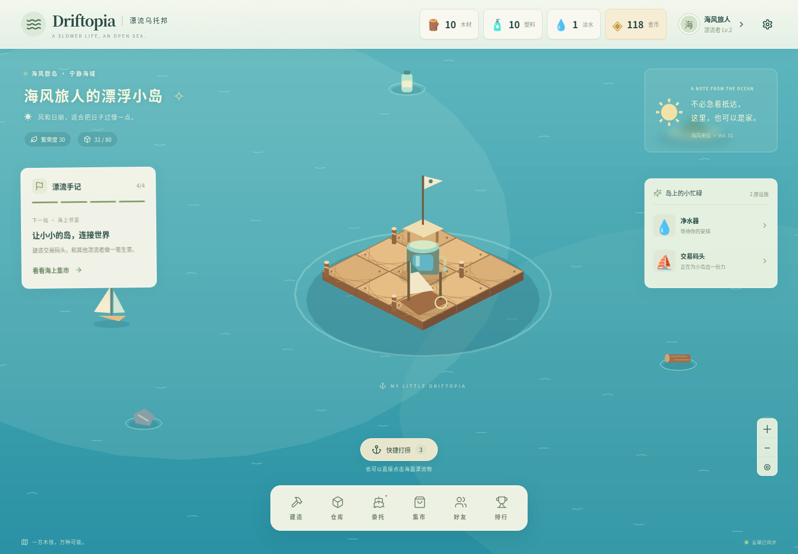
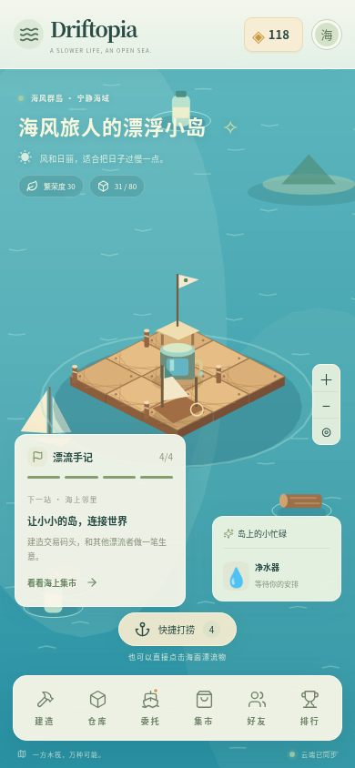
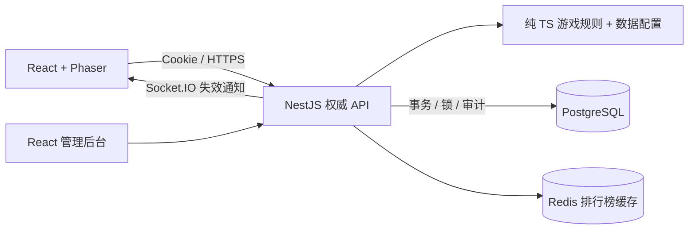

# Driftopia · 漂流乌托邦

一方木筏，万种可能。原创 H5 多人海上生存经营游戏的v0.2 可运行纵向切片。

从打捞第一块木材，到生产淡水、交付商船委托，再与另一位漂流者完成真实交易。所有经济状态由服务端验证并持久化到 PostgreSQL；前端不决定资源或金币。



<details><summary>移动端截图</summary>



</details>

v0.2 新增自动续产、回岛收成提示、批量购买与订单轮换。操作截图：[自动生产](docs/screenshots/automation.png)、[手机集市](docs/screenshots/market-mobile.png)。

## 已实现

- 注册、登录、HttpOnly Cookie 会话；跨账号云端存档隔离。
- Phaser 原创程序绘制海面、等距木筏、漂流物和建筑；鼠标/触摸点击、拖动、缩放。
- 服务端生成和验证的打捞、8 种资源、仓库容量、9 类建造（含地板），放置、移动、三级升级。
- 持久化生产队列：手动最多 3 批，自动续产最多预排 30 批；预扣材料、离线结算、最近收成提示、满仓暂停与重复领取保护。
- 等级解锁、优先发放未见委托的商船订单、金币经验、四步新手引导。
- 真实玩家市场：筛选、挂牌、按数量批量购买、撤单、交易历史、整数手续费、幂等重试与并发保护。
- 玩家搜索、单向好友列表、只读基地访问，三类排行榜、Redis 重建与数据库回退。
- Socket.IO 状态失效通知、5 秒状态同步。
- 独立管理后台：服务端权限、玩家与交易查看、经济指标、基础异常规则、版本化配方与订单奖励审计。
- 严格 TypeScript、Zod、单元/数据库集成/双浏览器 E2E、Docker、CI、经济模拟和工程文档。

这是可迭代的 MVP，不是完整商业游戏。探索海域、居民 AI、周期合作、复杂动效/音效、微信小游戏适配、密码找回、邮件验证和长期经济平衡仍在路线图中。自动续产需主动开启，离线只推进已预排的最多 30 批；重新同步存档时收取并从当前时间续排。好友目前为单向收藏，不是双向申请。

## 技术栈

Node.js 24、pnpm 11、TypeScript、React 19、Vite 7、Phaser 3、Zustand、自定义响应式 CSS；NestJS 11、Prisma 6.19（JavaScript engine + 官方 PostgreSQL adapter）、PostgreSQL 17、Redis 7、Socket.IO；Vitest、Playwright、ESLint、Prettier。

当前无需要可靠后台队列的任务，因此未引入 BullMQ。UI 使用独立 CSS 而非 Tailwind。需要更多任务/视觉体系时再引入，避免未使用依赖。

## 本地启动

要求：Node.js 24、pnpm 11.25.0、Docker Compose v2。

```sh
corepack enable
corepack prepare pnpm@11.25.0 --activate
cp .env.example .env
docker compose up -d --wait
pnpm install --frozen-lockfile
pnpm db:generate
pnpm db:migrate
pnpm db:seed
pnpm dev
```

游戏端口 `5173`，后台端口 `5174`，API 端口 `3001`。在本机浏览器访问对应端口。先创建账号；不会预置默认管理员或共享密码。管理员配置：在 `.env` 将 `ADMIN_EMAIL` 设置为一个已注册的账号邮箱，再运行 `pnpm db:seed`。

云工作区运行 `bash scripts/setup-cloud.sh` 准备依赖及服务。设置脚本不会覆盖已有 `.env`，不会重置数据库。每个云任务已经隔离，直接使用当前仓库，不需要额外 worktree。配置与进程恢复见 [开发说明](docs/DEVELOPMENT.md)。

## 验证

```sh
pnpm typecheck
pnpm lint
pnpm test
pnpm build
# 下列命令需要数据库和正在运行的 API
pnpm test:integration
# E2E 还需要 web 服务
pnpm exec playwright install chromium
pnpm test:e2e
# 已有系统 Chromium 时：
PLAYWRIGHT_CHROMIUM_EXECUTABLE_PATH=/usr/bin/chromium pnpm test:e2e
pnpm economy
```

E2E 创建两个独立浏览器会话，经 UI 注册、打捞、建造、生产、交付订单、买卖淡水，再验证刷新及重新登录的存档。集成测试创建并清理自己的测试用户；E2E 保留带 `voyage-`、`canvas-`、`auto-` 邮箱前缀的测试账号用于检查，不要对生产数据库运行测试。

## 架构



```text
apps/web           游戏 UI、Phaser 场景、Zustand
apps/api           会话、游戏事务、市场、社交、管理 API
apps/admin         管理后台
packages/shared    Schema 与 API 类型
packages/game-config 资源、建筑、配方、等级、订单配置
packages/game-engine 纯函数经济规则
packages/ui        通用显示格式
prisma             数据模型、版本化 SQL 迁移、seed
scripts            迁移执行、经济模拟、云环境准备
```

## 文档与部署

- [游戏设计](docs/GAME_DESIGN.md) · [架构](docs/ARCHITECTURE.md) · [数据库](docs/DATABASE.md)
- [经济](docs/ECONOMY.md) · [API](docs/API.md) · [开发](docs/DEVELOPMENT.md)
- [部署](docs/DEPLOYMENT.md) · [路线图](docs/ROADMAP.md) · [验收记录](docs/VALIDATION.md)

`pnpm build` 输出 `dist/web`、`dist/admin` 和 `dist/api`。生产通过反向代理提供静态文件并转发 `/api` 与 `/socket.io`；启用 HTTPS、设置精确 `WEB_ORIGINS`、持久化数据库卷并使用独立生产凭据。Docker 镜像和 Nginx 示例位于 `infra/`，当前交付验证了本环境运行，未发布到公网。
