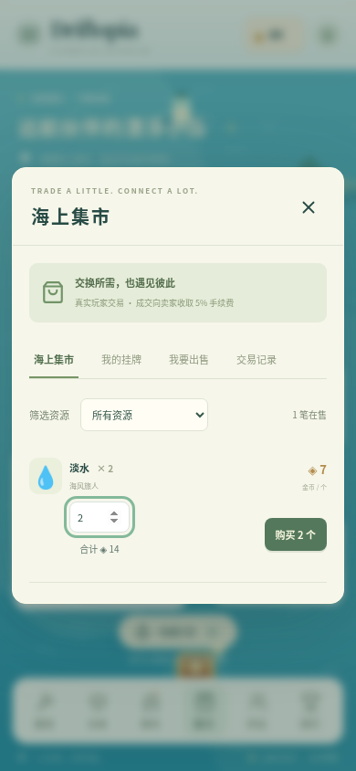
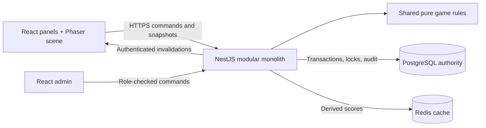
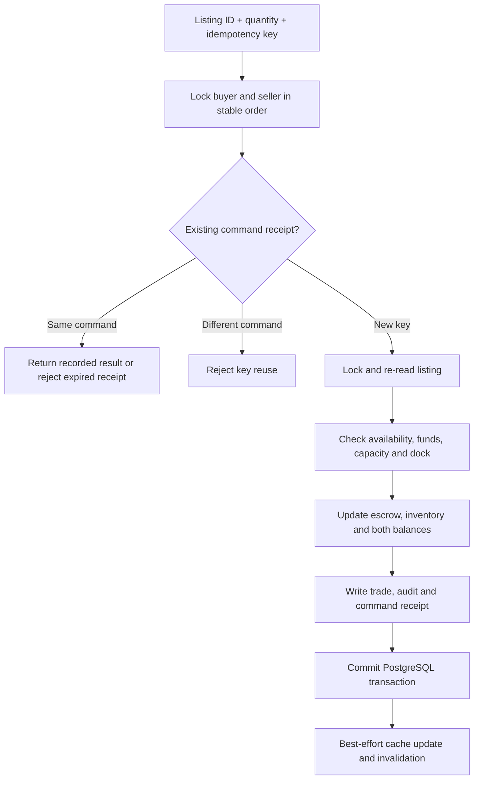

# Driftopia · 漂流乌托邦

**A multiplayer ocean survival and management game built with TypeScript — v0.3.0.** Start with a small raft, salvage materials, run production, fulfil merchant orders and trade resources with other players. The game UI is in Chinese; the engineering documentation below explains the implementation and its limits.

The project demonstrates a full-stack product with a server-authoritative economy, real PostgreSQL settlement, reconnectable browser clients and a reproducible test environment. It extends the original game rather than replacing it with a portfolio mockup.

**Public demo: not deployed yet.** A server and domain have not been provided. Remote CI remains unverified because GitHub API access from this workspace returned 403; this does not establish a passing or failing hosted run. See [deployment status and prerequisites](docs/DEPLOYMENT.md). To play now, follow the local setup below.


<details>
<summary>Mobile and production screenshots</summary>




[Automatic production](docs/screenshots/automation.png). These screenshots were regenerated from the v0.3.0 browser acceptance run with animation disabled for stable captures.

</details>

## Playable product

The complete loop is **salvage → build → produce → fulfil orders → expand → trade**.

- Register and sign in; the server creates and persists a personal 3×3 raft, inventory and progression. Optional guest entry creates a quota-limited real account with a default 24-hour lifetime.
- Salvage server-generated resources; place, move and upgrade buildings; expand the raft and warehouse.
- Run production while away. Manual queues contain up to three batches; optional automation reserves inputs for up to thirty batches and reports harvested output on return.
- Complete merchant orders for coins and experience, unlocking additional production chains.
- List escrowed resources, buy a chosen quantity from another account, find all your active listings in a separate tab, cancel unsold listings and inspect trade history. Both sides' assets update in one transaction.
- Search players, bookmark friends, see online presence, view public islands and compare three leaderboards.
- Follow a five-step introduction, use a placement preview and enjoy a visual day/night cycle; sound is optional and reduced motion is supported.
- Manage recipe and order-reward versions through a separate role-protected admin application.

Friends are currently **one-way bookmarks**, and visits are read-only. Offshore boats and distant islands are scenery. There is no combat, exploration progression, resident simulation or monetization. Long-term economy balance is unfinished; this is a playable engineering portfolio, not a claim of commercial content completeness.

## Engineering at a glance

| Layer        | Implementation                                                                                 |
| ------------ | ---------------------------------------------------------------------------------------------- |
| Browser      | React 19, Vite 7, Phaser 3, Zustand, responsive CSS                                            |
| API          | Node.js 24, NestJS 11, Socket.IO, Zod                                                          |
| Persistence  | PostgreSQL 17, Prisma 6.19.3 JavaScript client engine with the official `pg` adapter           |
| Cache        | Redis 7 for rankings; bounded one-second in-process cache for public market views              |
| Shared rules | Strict TypeScript packages for rules, config and transport contracts                           |
| Verification | Vitest, real PostgreSQL integration tests, Playwright browser tests                            |
| Delivery     | Docker Compose, Caddy HTTPS, versioned SQL migrations, GitHub Actions, backup/restore runbooks |



The browser submits intent, never balances or reward values. Economic writes share player locks, transactional audit records and idempotency receipts. Redis and WebSocket availability do not determine whether a trade has committed.

For a fast code review, start with [`game.ts`](apps/api/src/game.ts) (`mutate` and `buyListing`), [`production.ts`](apps/api/src/production.ts), [`game-engine`](packages/game-engine/src/index.ts), and the [real-database integration scenarios](tests/economy.integration.test.ts).

## Run locally

Prerequisites: Git, Node.js 24, pnpm 11.25.0 and Docker with Compose v2. Start Docker before running these commands.

```sh
git clone https://github.com/Logic-syd/Driftopia.git
cd Driftopia
npm install --global pnpm@11.25.0
cp .env.example .env
docker compose up -d --wait
pnpm install --frozen-lockfile
pnpm db:generate
pnpm db:migrate
pnpm db:seed
pnpm dev
```

On Windows PowerShell, replace `cp .env.example .env` with `Copy-Item .env.example .env`. Open the game on port **5173** of your computer; the admin app uses **5174**, and the API uses **3001**. Vite proxies HTTP and Socket.IO to keep browser cookies same-origin. Register a player to begin; there is no shared default administrator password.

For two-player testing, use a normal and a private browser window, register two accounts and build a trading dock on each island. Have one player sell two water at seven coins each; the buyer pays fourteen coins and the seller receives thirteen after the rounded 5% fee.

Administrator access is explicit: register a separate account, set `ADMIN_EMAIL` to its email on the server, then run `pnpm db:seed`. Never reuse development database credentials in a public environment. The [development guide](docs/DEVELOPMENT.md) covers cloud setup, process recovery and migrations.

## Reliability decisions

| Concern            | Approach                                                                                 | Decision                                                                         |
| ------------------ | ---------------------------------------------------------------------------------------- | -------------------------------------------------------------------------------- |
| Service boundaries | Keep related settlement in one deployable API and database                               | [Modular monolith](docs/ADR/0001-modular-monolith.md)                            |
| Client trust       | Validate ownership, time, resources, costs and rewards on the server                     | [Server authority](docs/ADR/0002-server-authoritative-economy.md)                |
| Concurrent trading | Escrow, sorted player locks, listing row lock, conditional decrement, one commit         | [Transactions and retries](docs/ADR/0003-market-transactions-and-idempotency.md) |
| Cache failure      | Rebuildable rankings and short-lived market views; settlement always rechecks PostgreSQL | [Cache strategy](docs/ADR/0004-disposable-ranking-cache.md)                      |
| Offline progress   | Persist prepaid jobs and settle finite queues from the server clock                      | [Offline production](docs/ADR/0005-bounded-offline-production.md)                |

A purchase follows this transaction boundary:



See [architecture and WebSocket sequence](docs/ARCHITECTURE.md), [data model and constraints](docs/DATABASE.md), and [API contracts](docs/API.md). Notification delivery is best effort; reconnecting clients recover from database-backed HTTP state rather than replaying economic deltas.

## Tests, measurements and delivery evidence

```sh
pnpm lint
pnpm typecheck
pnpm test
pnpm test:integration  # PostgreSQL, Redis and the API must be running
pnpm build
pnpm exec playwright install chromium
pnpm test:e2e          # Also requires the web service
pnpm economy          # Deterministic economy model, not a load test
```

Use a disposable development/test database. Integration fixtures clean up their own records; browser tests may leave accounts for inspection. `PLAYWRIGHT_CHROMIUM_EXECUTABLE_PATH` can select an existing system Chromium.

The strategy separates deterministic rule/client transport tests, real-database atomicity/concurrency checks, HTTP/WebSocket security tests and browser gameplay acceptance. Browser acceptance covers real logout/return, two-account asset reconciliation, friends/presence, rankings, guest access, offline recovery and owner listing cancellation; protocol tests cover duplicate/out-of-order notifications. The [validation report](docs/VALIDATION.md) records commands, observed results and incomplete acceptance criteria. The [performance report](docs/PERFORMANCE.md) contains the reproducible 100/500-user workload, completed measurements, hardware and limitations; its numbers are not a cloud capacity guarantee. The [economy model](docs/ECONOMY.md) describes balance problems separately from API throughput.

GitHub Actions defines lint, type checking, unit/integration tests, builds and browser checks. The presence of a workflow file is not evidence of a successful hosted run; final totals and command outcomes are maintained in the validation report. [Deployment](docs/DEPLOYMENT.md) and [operations](docs/OPERATIONS.md) document HTTPS, environment management, resource limits, backup and recovery. [Development records](docs/DEVELOPMENT_LOG.md) distinguish implemented changes from executed checks.

## Trade-offs and next steps

The current architecture targets a bounded demo on one API instance. In-process presence and rate limits, common player locks, ranking repair work and state synchronization queries need further work before horizontal scaling. There is no durable event outbox; HTTP resynchronization is the recovery mechanism. Expired idempotency receipts preserve rejection tombstones, so payload cleanup does not eliminate long-term key storage growth.

Automatic production is bounded by already-paid jobs, not an eight-hour catch-up simulation. Email verification, password recovery, account deletion, full historical pagination, season archives and mature economic balancing remain unfinished. Broader game content is deliberately behind correctness and operational readiness.

The [baseline technical audit](docs/TECHNICAL_AUDIT.md) preserves the original findings. The [prioritized roadmap](docs/ROADMAP.md) and [validation report](docs/VALIDATION.md) show what still blocks a public release.

```text
apps/web             Game UI, Phaser scene, server snapshot store
apps/api             Auth, economic transactions, production, realtime, operations
apps/admin           Role-protected management UI
packages/game-config Resource, recipe, building and progression definitions
packages/game-engine Pure economic and placement rules
packages/shared      Runtime schemas and API types
packages/ui          Shared display helpers
prisma               Data model, immutable SQL migrations and seed
scripts              Migration runner, setup, economic and operational tools
```
