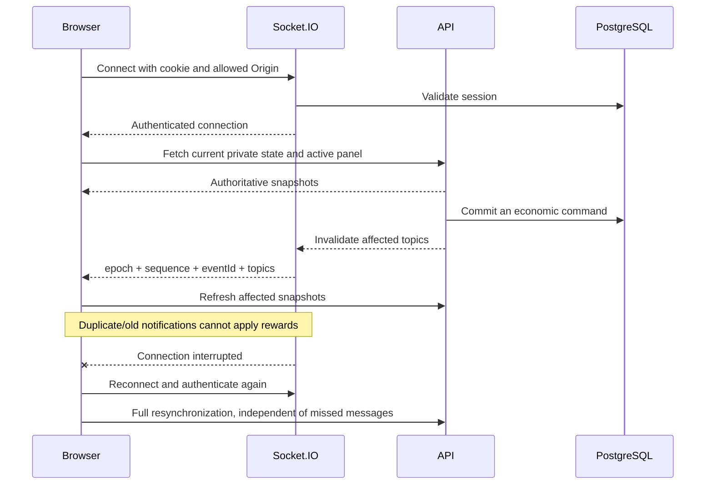

# Architecture

Driftopia is a modular monolith with a browser game, an independent admin UI and one authoritative API. The [ADRs](ADR/README.md) explain the major choices; [validation](VALIDATION.md) and [performance](PERFORMANCE.md) provide execution evidence rather than architecture claims.

## Boundaries

| Module        | Owns                                                                                           | Does not own                                                    |
| ------------- | ---------------------------------------------------------------------------------------------- | --------------------------------------------------------------- |
| `apps/web`    | React panels, Phaser visuals/input, UI preferences and a server state snapshot                 | Reward calculation, final balances, durable production progress |
| `apps/admin`  | Inspection and versioned configuration forms                                                   | A bypass around server role checks or player settlement         |
| `apps/api`    | Sessions, authorization, transactions, production settlement, public queries and notifications | Presentation or a second economic source of truth               |
| `game-config` | Baseline recipes, resources, buildings and level thresholds                                    | Mutable player records                                          |
| `game-engine` | Pure validation and integer calculations                                                       | Database, network or clock I/O                                  |
| `shared`      | Zod command schemas and transport types                                                        | A guarantee that an arbitrary browser payload is trusted        |
| PostgreSQL    | All durable accounts, assets, jobs, orders, trades, audit and receipts                         | Browser rendering state                                         |
| Redis         | Rebuildable public ranking scores                                                              | Inventory, currency or settlement eligibility                   |

React owns modal/UI interaction while Phaser owns the isometric scene. They coordinate selected buildings and placement intent through Zustand. The store holds server snapshots; local preferences or a dismissed harvest report cannot mint inventory.

## State and transaction flow

A command validates runtime input and derives the acting player from the session. `mutate` opens a PostgreSQL transaction, acquires transaction advisory locks, checks the idempotency receipt and executes the domain operation. The audit and command result commit with the economic change. The transaction uses READ COMMITTED isolation; correctness requires all economic write paths to hold the shared player locks.

```mermaid
sequenceDiagram
  participant Browser
  participant API
  participant PG as PostgreSQL
  participant Cache as Redis / realtime
  Browser->>API: POST intent + session cookie + idempotency key
  API->>API: Authenticate and validate payload
  API->>PG: Begin; sorted player advisory locks
  API->>PG: Check command fingerprint and receipt
  alt Successful prior command
    PG-->>API: Recorded response or expired tombstone
  else New command
    API->>PG: Validate and update authoritative state
    API->>PG: Write audit + result receipt
    API->>PG: Commit
    API-->>Cache: Best-effort derived update / invalidation
  end
  API-->>Browser: Result
  Browser->>API: GET current state
  API-->>Browser: Database-backed snapshot
```

For market purchases, add a `FOR UPDATE` listing lock after the sorted player locks. Listing availability is reread and conditionally decremented. Both balances, transferred inventory and the immutable trade are one commit. Cancellation locks the seller, so it cannot refund goods while a concurrent purchase also delivers them. The exact flow and retry failure cases are documented in [ADR 0003](ADR/0003-market-transactions-and-idempotency.md).

Canonical argument fingerprints make object key ordering irrelevant while preserving array order and values. Different arguments with the same key fail. Expired replay payloads leave rejection tombstones so an old committed command does not become executable after cleanup. The client reuses the same key for a transport retry; a new click is a new command.

## Production and lazy state maintenance

A production task snapshots its recipe, configuration version and server timestamps. Inputs are reserved at scheduling time. Manual queues have at most three pending batches; automatic queues have at most thirty. The API settles completed automatic jobs under the player lock when the authenticated client synchronizes, preserving batches that cannot fit and refilling from the current time or the existing queue's end.

State synchronization reuses the island/inventory snapshot loaded inside the player lock for automatic settlement, and reloads it only if settlement actually changed records. This reduces duplicate reads without sharing private state across requests or weakening the lock.

No player or building needs a process timer. An API restart cannot erase production. Reading a countdown is not a claim, and jobs created on return never gain retroactive progress. Turning automation off does not refund prepaid inputs or cancel existing jobs. [ADR 0005](ADR/0005-bounded-offline-production.md) describes the bounded offline semantics.

`GET /api/state` is consequently a private synchronization endpoint with bounded side effects: production settlement, salvage replenishment and order issuance. It is not suitable for CDN caching or a read replica. This is a pragmatic small-system boundary; separating synchronization from a cheap read is a future performance option.

## Realtime consistency

The database is authoritative. Socket.IO sends invalidation topics, never economic deltas that must be applied exactly once. Connection authentication uses the same server-side session as HTTP, and private rooms are assigned by the server. There is no client-controlled arbitrary room subscription.



An epoch distinguishes API process lifetimes; sequence and event IDs support stale/duplicate notification handling. They are not a durable database event log. A new connection or process epoch prompts HTTP refresh, and periodic foreground synchronization repairs missed notifications. The sequence is process-wide; gaps may be events addressed to other players, so a gap alone is not treated as missing private state. Session revocation/expiry disconnects sockets. Friends' online state is ephemeral presence, not a promise that a person is actively looking at the game.

Realtime and rate-limit state currently assume one API instance. Multiple replicas require a shared Socket.IO adapter, presence and rate-limit coordination, and a strategy for global event identity. A durable outbox is deferred because clients already recover from snapshots and no external guaranteed-delivery consumer exists.

## Cache policy

Derived leaderboards use Redis. Public market browsing additionally uses a bounded one-second in-process cache; personal state and economic operations do not use it. Successful commands update affected scores; controlled rebuilds repair or initialize rankings. Cache-hit leaderboard reads do not rebuild all players. A missing/expired 60-second week marker or absent sorted set triggers a single in-process rebuild shared by concurrent requests; a global one-minute timer also repairs the cache. PostgreSQL fallback maintains functionality when Redis fails. Weekly scores normalize to the current UTC week before comparison.

The market cache has at most nine resource-filter keys and combines concurrent reads of the same key. Successful listing, purchase and cancellation commands clear it after commit. A generation counter prevents a query already in flight from restoring data into a newer generation. The owner-only `mine=true` view always queries PostgreSQL, so players can retrieve all their active listings independently of the public latest-100 limit. A stale displayed offer can still fail at purchase time because the command rereads/locks the listing.

Cache freshness is weaker than asset consistency. A lost post-commit cache update may briefly show an old rank, but cannot undo a trade or change a balance. Rebuild cost grows with player population and must be measured before scaling. [ADR 0004](ADR/0004-disposable-ranking-cache.md) documents this boundary.

## Persistence, delivery and operations

Prisma 6.19.3 uses its official JavaScript client engine and `@prisma/adapter-pg`. In this environment, native Prisma engine downloads were unavailable; the JavaScript migration CLI also failed on PostgreSQL's system `name` type. Migration execution therefore uses the explicit `pg` runner in `scripts/migrate.ts`: an exclusive advisory lock, SHA-256 verification, one transaction per SQL file and `_driftopia_migrations` history. Applied files remain immutable. This workaround does not disable TLS or package integrity checks.

The deployment target is same-origin HTTPS at an edge proxy, separate API/static delivery, persistent PostgreSQL, disposable Redis and resource limits. Read [deployment](DEPLOYMENT.md) and [operations](OPERATIONS.md) for actual commands and current verification status. A configuration file or built image alone does not satisfy public-demo acceptance.

## Known boundaries

The monolith contains large controller and game-service modules; isolating rule functions and transaction entry points is deliberate, but further feature extraction remains useful. Searches and histories use bounded result sets rather than complete cursor pagination. Audit and idempotency tombstones require retention planning. Authenticated synchronization performs several relational queries and serializes each player's state updates, so headcount cannot be inferred from a single successful browser session.

Email recovery/verification, multi-region operation, high availability, comprehensive account erasure and a long-term content economy are not implemented. See the [roadmap](ROADMAP.md) and measured [performance limits](PERFORMANCE.md).
