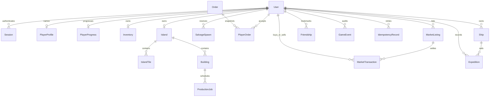

# Data model and consistency

The authoritative definitions are [`prisma/schema.prisma`](../prisma/schema.prisma) and immutable SQL files in [`prisma/migrations`](../prisma/migrations). All resource quantities and coin amounts are integers. SQL CHECK constraints supplement API validation because Prisma's schema cannot express every invariant.

## Main relationships

| Model               | Identity / constraint                                     | Responsibility                                                                                           |
| ------------------- | --------------------------------------------------------- | -------------------------------------------------------------------------------------------------------- |
| `User`              | UUID; unique email                                        | Password digest, server role, guest flag and fixed guest expiry                                          |
| `Session`           | Hashed token primary key; user FK                         | Server-side session expiry; raw token exists only in the cookie                                          |
| `PlayerProfile`     | User FK/PK                                                | Public display name, not necessarily unique                                                              |
| `PlayerProgress`    | User FK/PK                                                | Coins, XP, prosperity, tutorial counters, weekly score and week key                                      |
| `Inventory`         | User FK/PK                                                | JSONB bundle of eleven allowed nonnegative integer resources; old eight-key saves remain valid           |
| `Island`            | UUID; unique user FK                                      | Personal base                                                                                            |
| `IslandTile`        | UUID; unique `(islandId,x,y)`                             | Raft floor coordinates                                                                                   |
| `Building`          | UUID; unique `(islandId,x,y)`                             | Kind, position, level and `autoEnabled`                                                                  |
| `ProductionJob`     | UUID; building FK                                         | Recipe snapshots, configuration version, times and collection status                                     |
| `SalvageSpawn`      | UUID; user FK                                             | Server-selected reward and availability/claim timestamps                                                 |
| `Order`             | Stable code                                               | Seeded and administratively configurable template                                                        |
| `PlayerOrder`       | UUID; user/template FKs                                   | Player-specific reward/input snapshot and completion/expiry                                              |
| `MarketListing`     | UUID; seller FK                                           | Escrowed quantity, unit price and `ACTIVE/SOLD/CANCELLED` state                                          |
| `MarketTransaction` | UUID; listing/buyer/seller FKs                            | Completed quantity, total, fee and time                                                                  |
| `Friendship`        | Composite `(userId,friendId)`                             | Directed bookmark; self-bookmarks forbidden                                                              |
| `GameEvent`         | UUID; user FK                                             | Command audit, automatic harvests and seller-income events                                               |
| `IdempotencyRecord` | Composite `(userId,key)`                                  | Command fingerprint, optional result, creation and replay expiry                                         |
| `GameConfigVersion` | Increasing integer ID                                     | Actor ID, configuration scope/value and time                                                             |
| `Ship`              | UUID; unique `(userId,kind)` and `(id,userId)`            | Three ship kinds, level 1–3, durability 0–100; no permanent destruction                                  |
| `Expedition`        | UUID; composite ship/owner FK; one active voyage per ship | Immutable rule and private outcome snapshots, persisted times, choice, committed result and claim status |

The database requires nonnegative coins/XP/prosperity, valid resource keys and integer inventory, positive transaction quantities/totals, fees between zero and total, distinct buyer/seller, building levels 1–3 and valid production/listing states. Placement adjacency, warehouse capacity and ownership remain application-level checks under locks.

## Atomic boundaries

Registration creates the account, profile, progression, inventory, island, initial tiles, salvage and session in one transaction. The response cookie is written only after that commit. Production scheduling reserves inputs with job creation; collection changes inventory and collection status together. Order completion removes requirements and awards coins/XP once.

Listing creation removes goods into escrow. Purchasing transfers escrow to the buyer and currency to the seller, less the fee. Cancellation returns only the remaining escrow. If returned stock cannot fit, the transaction fails and the listing stays active.

Exploration uses the same player-lock protocol. Dispatch charges supplies/coins/wear and persists the voyage in one transaction; choice charges extra costs/damage and records exactly one precommitted result; claim transfers cargo/XP and marks completion together. Ship ownership is also enforced by a composite foreign key. A partial unique index on `shipId WHERE status <> 'CLAIMED'` prevents overlapping assignments even outside application checks. SQL checks enforce valid kinds, levels, durability, regions, choices, status-specific nullability and chronological timestamps. Public projections exclude private outcomes; read-only snapshots use REPEATABLE READ. Completed voyage history is retained, with only twenty shown in the current UI.

Every economic mutation takes transaction advisory locks for affected player IDs in sorted order. Purchases then lock the listing row. READ COMMITTED is used; this is safe only while all resource writers participate in the same lock protocol. Advisory hash collisions reduce concurrency but do not weaken correctness. Admin recipe configuration does not directly mutate player inventory.

`GameEvent`, `MarketTransaction` and successful command receipts commit with their corresponding operation. Redis writes, market browse-cache invalidation and socket notifications occur after commit and cannot be used to determine whether the transaction happened. The one-second public market cache is a display optimization; settlement and owner-only listing reads always use PostgreSQL.

## Indexes and query scope

Existing indexes cover pending building jobs, active player salvage/orders, public scores, player search and both sides of trade history. The reliability migration adds:

- `(status, createdAt)` for the unfiltered active-market list, alongside `(status, resource, createdAt)` for filtering.
- `(sellerId, status)` for active-listing limits.
- `(userId, type, createdAt, id)` for the latest automatic-harvest report.
- `Friendship(friendId)` for presence notifications to followers.
- Guest creation and receipt-expiry indexes for bounded lifecycle queries.

An index is not a throughput claim. See [performance measurements](PERFORMANCE.md) for the workload, query changes and remaining synchronization costs. Full cursor pagination is not yet implemented for market/history/admin queries. A separate owner-only market query retrieves all of the authenticated seller's up to twenty active listings, independently of the public latest-100 view.

## Lifetime and retention

Normal sessions last seven days. Guests default to 24 hours and cannot recover their account after cookie loss/logout. Guest accounts use real records and normal rules. Expired guest sellers are excluded from market results and new purchases, but their records and historical trades are retained; there is no silent asset or audit deletion. The overall retained-guest quota intentionally bounds account growth until an operator chooses a retention policy.

Salvage expires after 180 seconds and orders after 30 minutes. Production jobs retain their immutable input/output snapshots and completion times; later recipe edits do not rewrite them.

Idempotency responses have a seven-day replay lifetime. Maintenance removes expired response payloads while keeping the user/key/fingerprint/expiry tombstone. An expired key is always rejected, even before compaction. Deleting the full record would reopen an old operation and is not a safe space-saving strategy.

`scripts/maintenance.ts` previews cleanup by default; `--apply` removes up to 1000 expired sessions and compacts up to 1000 expired receipt payloads per invocation. It does not erase users, trades, audit, completed jobs or tombstones. Long-term archival, account erasure and legal retention policy remain unfinished; foreign keys intentionally prevent casual deletion of trade participants.

## Migrations

`pnpm db:migrate` uses [`scripts/migrate.ts`](../scripts/migrate.ts), which takes an exclusive migration lock and records each directory name, content SHA-256 and completion time in `_driftopia_migrations`. Each SQL file executes in one transaction. Changing an applied file causes a checksum failure; corrections require a new migration.

| Migration                  | Change                                                                                                                                                              |
| -------------------------- | ------------------------------------------------------------------------------------------------------------------------------------------------------------------- |
| `202610120001_initial`     | Initial schema and indexes                                                                                                                                          |
| `202610120002_constraints` | Economic CHECK constraints and JSONB inventory validation                                                                                                           |
| `202610120003_automation`  | Add `Building.autoEnabled`, default false for existing saves                                                                                                        |
| `202610130001_reliability` | Guest fields, expiring/compactable receipts and query indexes; retain existing balances, jobs and trades                                                            |
| `202610150001_exploration` | Add Ship/Expedition with ownership, active-voyage uniqueness and phase/time checks; extend the inventory validator for seed/alloy/relic without rewriting old saves |

Do not mix this migration history with `prisma migrate deploy`, and do not use `db push` as an upgrade path. Prisma generates the JavaScript client; reviewed SQL migrations are applied by the explicit runner. Production backup/restore procedures and observed drill results are in [operations](OPERATIONS.md).
