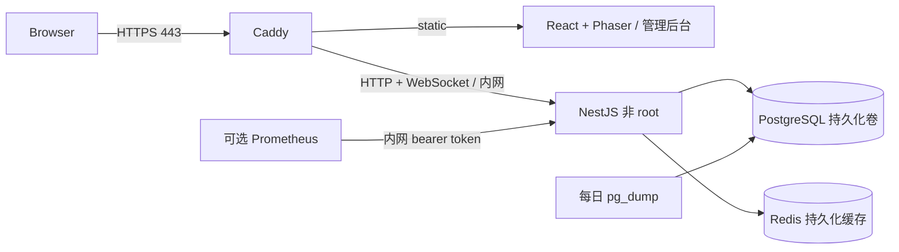

# 生产部署

当前仓库包含可自托管的生产交付流程。**公网演示尚未部署**：本次环境没有可使用的服务器、域名 DNS、SSH 部署凭据或已配置的 GitHub `production` environment。`play.example.com` 仅为占位符。容器验证结果与公网部署状态分开记录在 [OPERATIONS.md](OPERATIONS.md)。

v0.4 / Phase 3A 新增 `202610150001_exploration` 迁移、三个研究订单及 Ship/Expedition 运行角色权限。升级时沿用下述备份 → migrate → seed → grants → readiness 流程，不删除卷。当前 v0.4 已在开发 PostgreSQL 验证迁移与游戏回归；[OPERATIONS.md](OPERATIONS.md) 中的容器 HTTPS/备份演练是 v0.3 历史证据，本轮没有重新构建并部署生产容器，也未验证远程 CI。发布 v0.4 前需要再次执行目标环境演练。

## 运行模型

单台 Linux 主机 + Docker Engine / Compose v2.24.4 或更新版本。建议从 4 vCPU / 4 GB RAM 起步；这是容器资源预算建议，不代表已验证的在线承载量，真实负载测试见性能报告。



- `compose.production.yaml` 独立于开发 `compose.yaml`；PostgreSQL / Redis / API 没有宿主机公开端口。
- Caddy 使用域名签发/续期公开证书，HTTP 自动跳转 HTTPS；证书保存在 `caddy-data`。实际签发要求 DNS 指向主机、80/443 可达及正常 ACME 网络访问。
- API 仅信任固定 Caddy 内网地址 `172.29.18.10`。不要将 `TRUST_PROXY` 改为 `true`、任意 hop 数或整个公网。
- 同域 `/admin/` 提供管理 UI；API 仍独立验证 ADMIN 角色。没有默认管理员、共享密码或前端权限绕过。
- 数据库分为初始化/恢复专用 bootstrap 超级用户、非超级用户的 schema owner（迁移/备份），以及 API 的 DML 应用角色。API 不能创建/修改表或角色，迁移历史只读、交易/事件审计不可 UPDATE/DELETE；应用容器不持有 owner/bootstrap 密码。初始化脚本只适用于新卷，既有生产库需单独执行受控角色迁移，不能通过删卷升级。
- 生产镜像的 API 以 `node` 用户运行，只读根文件系统、去掉 Linux capabilities，写入仅限受限 `/tmp`。运行镜像保留生产依赖，迁移和 seed 预编译。
- 内存/CPU/PID、Redis 96 MB 缓存、数据库 60 连接上限、API 20 连接池、3 × 10 MB 容器日志、游客数量和 WebSocket 数量均有上限。单机固定预算不使用自动扩容；流量/磁盘费用仍需主机供应商设置预算告警。

## 首次安装

1. 准备主机、域名 A/AAAA 记录、80/443 入站规则。SSH 只向运营者开放；不要开放 PostgreSQL、Redis 或 API 端口。
2. 将仓库交付文件置于 `/opt/driftopia`，保持同目录结构。部署账号需要该目录写权限和 Docker 权限；Docker 组等价于主机管理权限，应限制该账号的 SSH key 用途。
3. `cp infra/production.env.example .env.production && chmod 600 .env.production`。分别运行五次 `openssl rand -hex 32` 生成 `POSTGRES_PASSWORD`、`POSTGRES_OWNER_PASSWORD`、`POSTGRES_APP_PASSWORD`、`REDIS_PASSWORD`、`METRICS_TOKEN`，填写真实 `DOMAIN`、`ACME_EMAIL` 和匹配的 API/WEB 镜像 digest。不要使用示例占位符。真实环境文件、secrets 和备份已被 Git 忽略。
4. 先运行 GitHub release workflow（`deploy=false`）产生经过 quality gate 的 GHCR 镜像。私有镜像由服务器使用最小 `read:packages` 权限凭据执行 `docker login ghcr.io`，凭据不得写入仓库。公开镜像不需要登录。
5. 执行 `bash scripts/deploy.sh`。它检查生产配置，拉取镜像，启动有健康检查的 PostgreSQL/Redis，备份数据库，执行事务迁移与 seed，再启动 API/Caddy 并检查 readiness。任何步骤失败均终止；不会自动删除卷或逆向数据库迁移。
6. 从服务器以外验证 `https://<实际域名>/api/ready` 和首页，并完成双账号核心游戏验收。`up --wait` 只证明容器就绪，不能代替公网 DNS、证书或浏览器验收。
7. 需要管理员时，先注册个人账号；使用一次性 `ADMIN_EMAIL` 注入 seed 进程授予角色。不要把管理员邮箱/密码预置在公开演示代码中。

```bash
# 一次性授权一个已注册的管理员账号。仅在受控主机执行。
docker compose --env-file .env.production -f compose.production.yaml \
  run --rm -e ADMIN_EMAIL=operator@your-domain.example migrate \
  node dist/ops/prisma/seed.js
```

Seed 只补缺失的订单模板，不覆盖已经调优的配置。SQL 迁移具有 advisory lock、事务和校验和；已应用的 migration 不可编辑，应增加新的迁移。发布前备份是恢复点，不代表每个 schema 变更都可无损回滚。

## 自动化交付

`.github/workflows/ci.yml` 在 push / PR，以及 reusable `workflow_call` 下执行：锁定依赖 → Prisma client / 迁移 / seed → lint → typecheck → unit → 真实 PostgreSQL 集成（并发/安全/实时）→ build → Playwright。所有失败阻断后续步骤，上传 trace、截图与运行日志。

`.github/workflows/release.yml` 手动触发，先完整调用上述 CI；只有通过才构建 API + Caddy 两个镜像并推送 GHCR。`deploy=true` 仅允许 `main` 分支，使用镜像 digest 通过 SSH 部署，最后从 Actions runner 验证公开 HTTPS。默认 `deploy=false` 只发布镜像。

仓库所有者必须在 GitHub 设置中配置：

- `production` environment：required reviewers、仅允许 `main`、禁止管理员绕过（如套餐支持）；YAML 中的 environment 名称本身不会自动建立这些保护。
- Secrets：`DEPLOY_HOST`、`DEPLOY_USER`、`DEPLOY_SSH_KEY`、预先通过可信渠道核对的 `DEPLOY_KNOWN_HOSTS`。工作流强制 host key 验证，不使用 `StrictHostKeyChecking=no`。
- Environment variable：`DEMO_URL=https://真实域名`。
- 服务器上预先写好的 `.env.production`。GitHub Actions 不传输数据库密码；发布包不包含任何真实环境文件。

当前交付没有声称 GitHub workflow 已运行通过，也没有声称公网发布成功；本次实际命令与结果见 [运行记录](OPERATIONS.md)。

## 本地生产镜像验证

```bash
# 常规主机
DOCKER_BUILDKIT=1 docker build -f infra/Dockerfile --target api -t driftopia-api:review .
DOCKER_BUILDKIT=1 docker build -f infra/Dockerfile --target web -t driftopia-web:review .
# 托管云环境通过代理构建：每次附加
# --secret id=proxy_ca,src="$CODEX_PROXY_CERT"
```

`infra/compose.smoke.yaml` 仅用于隔离的生产镜像演练：域名改为 `localhost`，Caddy 使用内部 CA，端口只绑定 loopback 8443/8080。复制 Caddy 生成的 CA 并用 `curl --cacert` 验证，**不要使用 `curl -k` 或关闭证书验证**。它不是公开 Demo，也不会申请公共证书。测试使用独立 project/卷，不能复用生产数据库。完成本地 CA 复制后，可运行 `python3 scripts/deploy-smoke.py --ca /tmp/driftopia-smoke-root.crt` 重复真实 HTTPS 游戏闭环；该脚本仅允许 localhost，并创建持久化测试账户，不要将其用于线上数据。

## 已知边界

- 单 API 实例；限流/实时 presence 的进程内部分不支持直接横向扩容。扩展前加共享限流、Socket.IO Redis adapter 和多实例故障演练。
- Prometheus 为可选 profile，默认不启用，告警规则需运营者另接 Alertmanager/通知渠道。
- 主机故障仍影响可用性；本方案没有托管数据库、多可用区或滚动零停机发布。
- 未配置真实外部域名、主机与访问凭据前，Test F 应保持 **Blocked**，不能用 localhost 或截图替代。

游客账户使用真实持久化经济，24 小时后停止登录和操作；默认每天最多 100 个、累计最多 500 个游客，不自动删除交易审计来腾出名额。名额耗尽返回明确错误，运营者可审查后提高上限或关闭 `GUEST_ENABLED`，不会自动扩大云资源。
